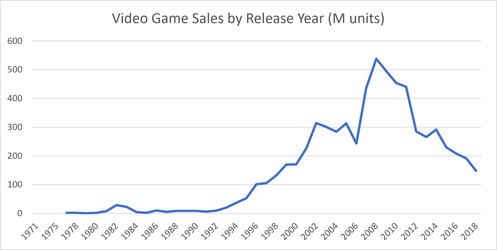
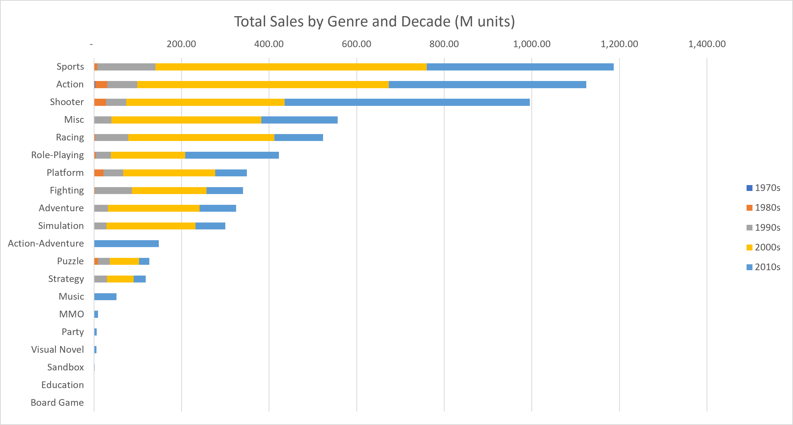
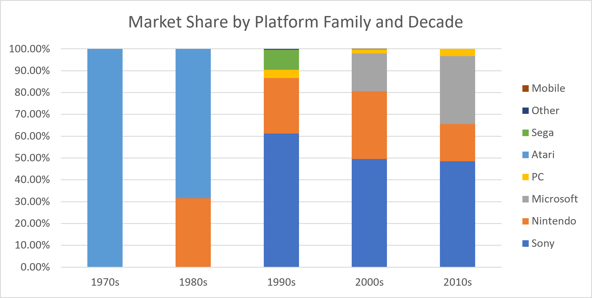
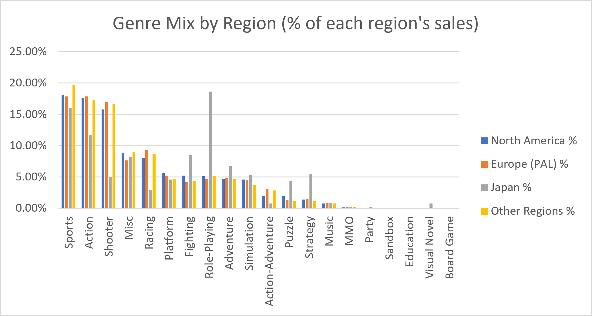
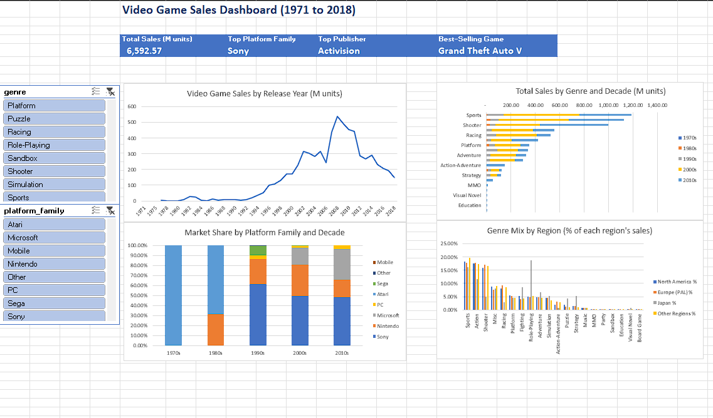

# Video Game Sales Analysis (Excel)

An end-to-end data analysis of global video game sales from 1971 to 2018, built entirely in **Microsoft Excel**: data profiling, cleaning with Power Query, PivotTable analysis, PivotCharts and an interactive dashboard.

## Charts

<table>
<tr>
<td width="50%"><b>Sales peaked in 2008 at 538M units and declined after 2011</b> </td>
<td width="50%"><b>Sports, Action and Shooter make up half of all sales. Shooters grew fastest in the 2010s</b> </td>
</tr>
<tr>
<td width="50%"><b>Atari ruled the 1980s, Sony has led since the 1990s, and Microsoft passed Nintendo in the 2010s</b> </td>
<td width="50%"><b>Japan buys Role-Playing games almost 4 times more than other regions, and very few Shooters</b> </td>
</tr>
</table>

## Interactive dashboard

The Dashboard sheet brings everything together: four summary cards, the four charts, and slicers that filter the summary cards, the sales trend and the regional chart by genre and platform family.

## Business questions

1. How did the global video game market grow and decline over the years?
2. Which genres sell best, and how has the genre mix changed by decade?
3. Which platforms and console makers dominated each era?
4. Who are the top publishers, and what are the best-selling games?
5. How do buying patterns differ between North America, Europe/PAL and Japan?

## Key findings

- **The market peaked in 2008** at 538 million units sold. The 2000s were the biggest decade, with about half of all tracked sales.
- **Sports, Action and Shooter games make up half of all sales.** Shooters became the top genre of the 2010s.
- **Sony has led every decade since the 1990s** and accounts for 49% of all tracked sales. **Microsoft** grew from 17% to 31% between the 2000s and the 2010s, passing Nintendo.
- **Activision is the top publisher** (723M units), and **Call of Duty** holds 7 of the 10 best-selling game spots. **Grand Theft Auto V** is the best-selling game (64M units), more than twice the next one.
- **North America buys half of all games.** **Japan** has a very different taste: Role-Playing is its #1 genre (19% of its sales, against about 5% elsewhere), while Shooters are only 5%.

Full answers, recommendations and data limitations: [docs/insights.md](docs/insights.md).

## Dataset

[Video Game Sales 2024](https://www.kaggle.com/datasets/asaniczka/video-game-sales-2024) from Kaggle, collected from VGChartz. It has 64,016 game releases from 1971 to 2024, with sales in millions of units by region, critic scores, publishers and release dates.

VGChartz stopped tracking most sales after 2018, so the trend analysis covers games released up to 2018 (6,592.57 million units in total).

## Process

| Step | What was done | Details |
| --- | --- | --- |
| 1. Profile | Counted rows, blanks and duplicates in every column, and found that sales data almost stops after 2018 | [data_profiling.md](docs/data_profiling.md) |
| 2. Clean | Power Query: removed unused columns, trimmed text, filled blank developers, removed 21 exact duplicates, and added `release_year`, `has_sales_data`, `data_period`, `decade` and `platform_family` | [cleaning_log.md](docs/cleaning_log.md) |
| 3. Analyse | One sheet of PivotTables per business question: Trend, Genre, Platform, Publishers and Regions | [analysis_notes.md](docs/analysis_notes.md) |
| 4. Visualise | Four PivotCharts and a Dashboard sheet with summary cards and slicers for genre and platform family | [analysis_notes.md](docs/analysis_notes.md#6-dashboard-dashboard-sheet) |
| 5. Conclude | Answers to the business questions, recommendations and limitations | [insights.md](docs/insights.md) |

## Excel skills used

- **Power Query:** data types, trimming and cleaning text, replacing values, custom columns (`if` logic, `Date.Year`, `List.Contains`), removing duplicates
- **Formulas:** `COUNTBLANK`, `COUNTIF`, `ROWS`, `INDIRECT`, `GETPIVOTDATA`
- **PivotTables:** report filters, Top 10 value filters, sorting, Show Values As (% of Column Total, % of Row Total), Count vs Sum
- **PivotCharts:** line, stacked bar, stacked column (as 100% shares) and clustered column charts
- **Dashboard:** summary cards linked to PivotTables, slicers with Report Connections across several PivotTables
- **Conditional formatting:** colour scales

## Repository structure

| Path | What it holds |
|---|---|
| `excel/video_game_sales_analysis.xlsx` | The workbook. Sheets: Dashboard, Profile, Trend, Genre, Platform, Publishers, Regions, Clean, Raw |
| `data/raw/vgchartz-2024.csv` | Original dataset, unchanged |
| `docs/data_dictionary.md` | What each column means |
| `docs/data_profiling.md` | Row counts, missing values and data quality checks |
| `docs/cleaning_log.md` | Every cleaning step and the reason for it |
| `docs/analysis_notes.md` | Tables and findings from each analysis |
| `docs/insights.md` | Key insights, recommendations and data limitations |
| `images/` | Dashboard screenshot and the four charts used in this README |

## How to use the workbook

1. Download `excel/video_game_sales_analysis.xlsx` and open it in Excel 2021 or Microsoft 365 on Windows.
2. Start on the **Dashboard** sheet. Click a genre or platform family in the slicers to filter the cards and charts. Use the clear filter button (top right of each slicer) to reset.
3. The sheets after it hold the PivotTables behind each chart. **Clean** is the Power Query output and **Raw** is the original data.

## Limitations

- Sales figures cover boxed retail copies only. Digital downloads and mobile app stores are missing, so PC and mobile look smaller than they really are.
- Many big Nintendo games have no sales figures in the source data.
- Figures are units sold, not revenue.

More detail in [docs/insights.md](docs/insights.md#limitations-of-the-data).
